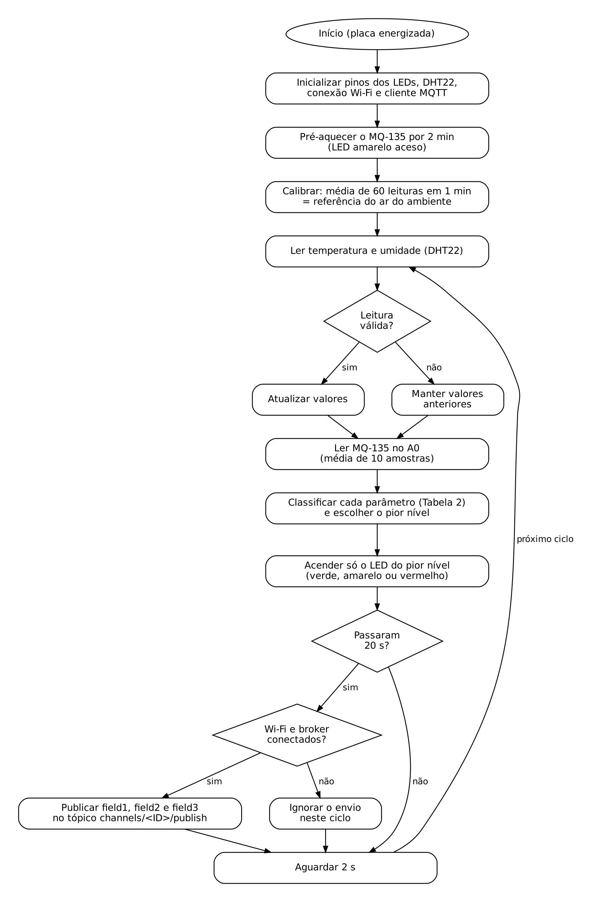
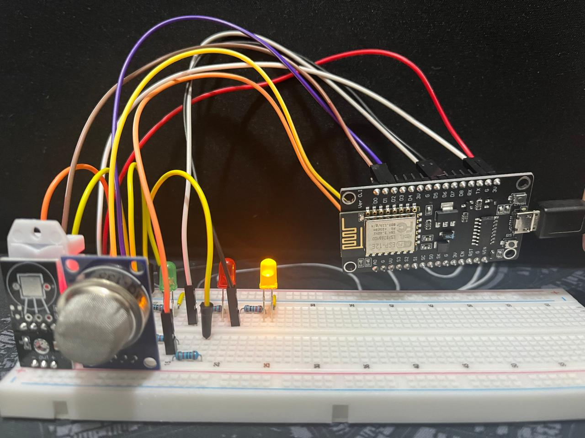
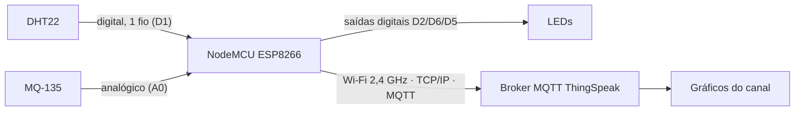
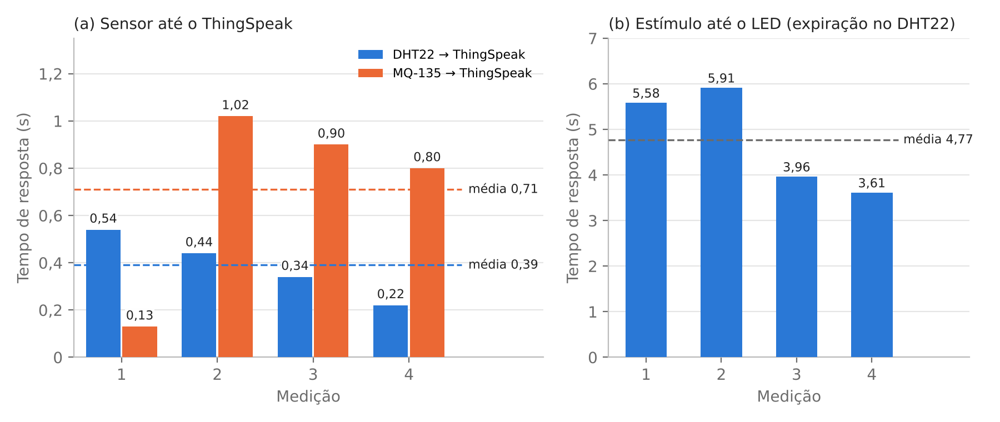

# Monitor de qualidade do ar em ambientes fechados (IoT + MQTT)

Protótipo de baixo custo que mede **temperatura**, **umidade relativa** e um **índice relativo de gases** em ambientes fechados. Ele acende um LED de alerta (verde, amarelo ou vermelho) e publica os dados via **MQTT** no broker da plataforma **ThingSpeak**, onde podem ser acompanhados em tempo real.

Projeto da disciplina _Objetos Inteligentes Conectados_, da Universidade Presbiteriana Mackenzie, alinhado ao **ODS 11** (Cidades e Comunidades Sustentáveis), meta 11.6, que trata da qualidade do ar.

---

## Sumário

1. [Como funciona](#como-funciona)
2. [Hardware](#hardware)
3. [Montagem](#montagem)
4. [Software](#software)
5. [Interfaces, protocolos e comunicação](#interfaces-protocolos-e-comunicação)
6. [Como reproduzir](#como-reproduzir)
7. [Resultados e dados](#resultados-e-dados)
8. [Estrutura do repositório](#estrutura-do-repositório)

---

## Como funciona

1. **Pré-aquecimento (2 min):** o MQ-135 aquece até estabilizar, com o LED amarelo aceso.
2. **Calibração (1 min):** a média de 60 leituras do MQ-135 vira a _referência_ do ar do ambiente. Por isso, ligue o protótipo em um ambiente ventilado.
3. **Ciclo de ~2 s:** o NodeMCU lê o DHT22 e o MQ-135, classifica cada parâmetro e acende **só o LED do pior nível**.
4. **Envio de ~20 s em ~20 s:** a cada 10 ciclos, publica os três valores no ThingSpeak via MQTT.
5. **Sem internet:** os LEDs continuam funcionando, o envio daquele ciclo é ignorado e a placa tenta reconectar no envio seguinte.

### Critérios de alerta

| Parâmetro                | 🟢 Verde (adequado) | 🟡 Amarelo (atenção)        | 🔴 Vermelho (crítico)           |
| ------------------------ | ------------------- | --------------------------- | ------------------------------- |
| Temperatura              | 21 a 26 °C          | até 3 °C fora da faixa      | mais de 3 °C fora da faixa      |
| Umidade relativa         | 35 a 65%            | até 10 pontos fora da faixa | mais de 10 pontos fora da faixa |
| Índice de gases (MQ-135) | abaixo de L1        | entre L1 e L2               | acima de L2                     |

- L1 = referência + 20%; L2 = referência + 50%.
- As faixas de temperatura e umidade seguem a NBR 17037, conforme comunicado da ABRAVA (2024).
- O MQ-135 não mede ppm. O valor é um índice relativo à referência da calibração.

### Fluxograma

<p align="center"></p>

---

## Hardware

| Item                                  | Qtd.    | Especificação                                        | Função                         |
| ------------------------------------- | ------- | ---------------------------------------------------- | ------------------------------ |
| NodeMCU V3 ESP8266 (ESP-12E, CH340)   | 1       | Wi-Fi 802.11 b/g/n 2,4 GHz, lógica 3,3 V, 4 MB flash | Controle e comunicação         |
| Módulo sensor MQ-135                  | 1       | Alimentação 5 V, saídas AO e DO                      | Detecção de gases              |
| Módulo sensor DHT22 (AM2302), 3 pinos | 1       | Alimentação 3,3 a 6 V, saída digital de um fio       | Temperatura e umidade          |
| LED 5 mm                              | 3       | Verde, amarelo e vermelho                            | Atuador (alerta visual)        |
| Resistor 220 Ω                        | 3       | —                                                    | Limitação de corrente dos LEDs |
| Resistor 10 kΩ                        | 2       | —                                                    | Divisor de tensão do MQ-135    |
| Protoboard 830 pontos                 | 1       | —                                                    | Montagem sem solda             |
| Jumpers macho-macho e fêmea-macho     | 1 conj. | —                                                    | Ligações                       |
| Cabo micro-USB **de dados**           | 1       | —                                                    | Alimentação e gravação         |

- O projeto **não usa** caixa nem peças impressas em 3D. A montagem é aberta, sobre a protoboard.
- O protótipo pode ser alimentado por qualquer fonte USB de 5 V, como um carregador de celular ou um power bank.

---

## Montagem

<p align="center"></p>

| Componente   | Pino do componente  | Liga em (NodeMCU)      |
| ------------ | ------------------- | ---------------------- |
| DHT22        | + (VCC)             | 3V                     |
| DHT22        | OUT (dados)         | D1                     |
| DHT22        | − (GND)             | G                      |
| MQ-135       | VCC                 | VU (5 V da USB)        |
| MQ-135       | GND                 | G                      |
| MQ-135       | AO                  | resistor de 10 kΩ → A0 |
| —            | A0                  | resistor de 10 kΩ → G  |
| LED verde    | ânodo (perna longa) | resistor de 220 Ω → D2 |
| LED amarelo  | ânodo               | resistor de 220 Ω → D6 |
| LED vermelho | ânodo               | resistor de 220 Ω → D5 |
| LEDs         | cátodo (lado chato) | G                      |

**Observações:**

- **Divisor de tensão:** a saída AO do MQ-135 chega a 5 V, mas a entrada A0 do NodeMCU aceita até 3,3 V. Os dois resistores de 10 kΩ reduzem a tensão máxima para cerca de 2,5 V.
- **Placa fora da protoboard:** o NodeMCU V3 é largo demais para uma protoboard de 830 pontos e ocupa todas as fileiras. Por isso, ele fica fora dela, ligado por 8 jumpers fêmea-macho.
- **Nome dos pinos:** nessa placa, 3V = 3,3 V, G = GND e VU = 5 V da USB.
- **Polaridade do DHT22:** confira antes de ligar. Invertido, ele aquece a placa e a desconecta do computador.

---

## Software

| Item                                             | Uso                                                        |
| ------------------------------------------------ | ---------------------------------------------------------- |
| Arduino IDE 2.x                                  | Programação, gravação e Monitor Serial                     |
| Pacote de placas **ESP8266** (esp8266 community) | Suporte ao NodeMCU (placa: _NodeMCU 1.0 (ESP-12E Module)_) |
| Biblioteca **PubSubClient** (Nick O'Leary)       | Cliente MQTT                                               |
| Biblioteca **DHT sensor library** (Adafruit)     | Leitura do DHT22                                           |
| ESP8266WiFi (vem com o pacote de placas)         | Conexão Wi-Fi                                              |
| Driver **CH340** (WCH)                           | Comunicação USB-serial da placa com o PC                   |

### Organização do código (`monitor_qualidade_ar.ino`)

| Função                           | O que faz                                                                                           |
| -------------------------------- | --------------------------------------------------------------------------------------------------- |
| `setup()`                        | Configura os pinos e o DHT22, inicia o Wi-Fi, define o broker, faz o pré-aquecimento e a calibração |
| `loop()`                         | A cada ~2 s: lê os sensores, classifica, aciona os LEDs e, a cada 10 ciclos, publica via MQTT       |
| `lerGas()`                       | Devolve a média de 10 leituras do pino A0 (MQ-135)                                                  |
| `nivel(valor, min, max, margem)` | Classifica um valor em 0 (adequado), 1 (atenção) ou 2 (crítico)                                     |

As credenciais (Wi-Fi e MQTT) e o tópico ficam no arquivo `secrets.h`, o equivalente a um `.env` neste projeto. O repositório traz apenas o modelo `secrets.example.h`.

---

## Interfaces, protocolos e comunicação



| Interface          | Detalhes                                                             |
| ------------------ | -------------------------------------------------------------------- |
| DHT22 → NodeMCU    | Digital, um fio (pino D1)                                            |
| MQ-135 → NodeMCU   | Analógica, pino A0, por divisor de tensão                            |
| NodeMCU → LEDs     | Saídas digitais D2, D6 e D5 (nível alto = aceso)                     |
| NodeMCU ↔ PC       | Serial via USB (CH340), 115200 baud                                  |
| NodeMCU → internet | Wi-Fi integrado do ESP8266 (802.11 b/g/n, **2,4 GHz**), pilha TCP/IP |

### MQTT

| Parâmetro            | Valor                                                                                           |
| -------------------- | ----------------------------------------------------------------------------------------------- |
| Broker               | `mqtt3.thingspeak.com`                                                                          |
| Porta e transporte   | 1883, TCP                                                                                       |
| Papel do NodeMCU     | Publicador (_publisher_)                                                                        |
| Tópico               | `channels/<ID_DO_CANAL>/publish`                                                                |
| Mensagem (_payload_) | `field1=<temperatura>&field2=<umidade>&field3=<índice de gases>`                                |
| QoS                  | 0 (único aceito pelo ThingSpeak)                                                                |
| Intervalo            | ~20 s (o plano gratuito aceita no mínimo 15 s entre envios)                                     |
| Autenticação         | Client ID, usuário e senha de um dispositivo MQTT do ThingSpeak, só com permissão de publicação |

Exemplo de mensagem real: `field1=26.6&field2=49.9&field3=44` corresponde a 26,6 °C, 49,9% de umidade e índice de gases 44.

**Campos do canal ThingSpeak:** Field 1 = Temperatura, Field 2 = Umidade, Field 3 = Gás MQ-135.

---

## Como reproduzir

1. **Monte o circuito** conforme a seção [Montagem](#montagem).
2. **Prepare a Arduino IDE:**
   - Em _File > Preferences > Additional boards manager URLs_, adicione `http://arduino.esp8266.com/stable/package_esp8266com_index.json`.
   - Em _Boards Manager_, instale **esp8266**.
   - Em _Library Manager_, instale **PubSubClient** e **DHT sensor library** (aceite instalar a dependência _Adafruit Unified Sensor_).
   - Se a placa não aparecer em _Tools > Port_, instale o driver CH340 e use um cabo USB de dados.
3. **Configure o ThingSpeak:**
   - Crie um canal com 3 campos (Temperatura, Umidade e Gás MQ-135) e anote o **Channel ID**.
   - Em _Devices > MQTT > Add a new device_, autorize o canal só com **Publish** e baixe as credenciais.
4. **Crie o `secrets.h`:** copie `monitor_qualidade_ar/secrets.example.h` para `monitor_qualidade_ar/secrets.h` (mesma pasta do `.ino`) e preencha o Wi-Fi (2,4 GHz), as credenciais MQTT e o Channel ID no tópico. Sem esse arquivo, o código não compila.
5. **Grave o código:** abra `monitor_qualidade_ar.ino`, selecione a placa _NodeMCU 1.0 (ESP-12E Module)_ e a porta COM, e clique em **Upload**.
6. **Acompanhe:** abra o Serial Monitor em **115200 baud**. Após ~3 min aparecem as leituras e, a cada ~20 s, as linhas `Publicado: ...`. Os gráficos aparecem no ThingSpeak, na aba _Private View_.

> ⚠️ Nunca publique o `secrets.h`. Ele já está no `.gitignore`.

---

## Resultados e dados

- Em ar limpo, o índice de gases ficou entre 38 e 52. Com vapor de álcool, chegou a 481.
- A expiração sobre o DHT22 levou a umidade a 79,5% e acendeu o LED vermelho.
- Acima de 26 °C, em um cômodo fechado com computador ligado, o LED ficou amarelo.
- Todas as mensagens chegaram ao ThingSpeak **em menos de 1 s** após a publicação. A média máxima estimada foi de 0,55 s, limitada pela resolução de 1 s dos registros da plataforma.
- O tempo do estímulo até a mudança do LED foi de **4,77 s** em média, determinado principalmente pela resposta do DHT22.

<p align="center"></p>

| Arquivo                      | Conteúdo                                                         |
| ---------------------------- | ---------------------------------------------------------------- |
| `dados/feeds_thingspeak.csv` | Dados exportados do canal ThingSpeak (horários em UTC)           |
| `dados/log_serial.txt`       | Publicações registradas no Monitor Serial (horário local, UTC−3) |
| `dados/tempos_resposta.csv`  | Medições de tempo de resposta e médias                           |

---

## Estrutura do repositório

```
monitor-qualidade-ar/
├── monitor_qualidade_ar/
│   ├── monitor_qualidade_ar.ino   # firmware
│   └── secrets.example.h          # modelo de credenciais (copiar para secrets.h e preencher)
├── docs/
│   ├── fluxograma.png
│   └── grafico_tempos_resposta.png
├── dados/
│   ├── feeds_thingspeak.csv
│   ├── log_serial.txt
│   └── tempos_resposta.csv
├── .gitignore                     # impede o envio do secrets.h
└── README.md
```

## Limitações e melhorias futuras

- O MQ-135 não é seletivo e não fornece ppm. Uma melhoria seria usar um sensor de CO₂ NDIR ou calibrar o MQ-135 contra um instrumento de referência.
- O calor do MQ-135 e da placa eleva a leitura do DHT22. O ideal é afastar o sensor das fontes de calor.
- A conexão na porta 1883 não é criptografada. Uma melhoria seria usar MQTT com TLS, na porta 8883.
- Outra evolução seria um atuador que aja sobre o ambiente, como um relé para ventilador ou exaustor.
